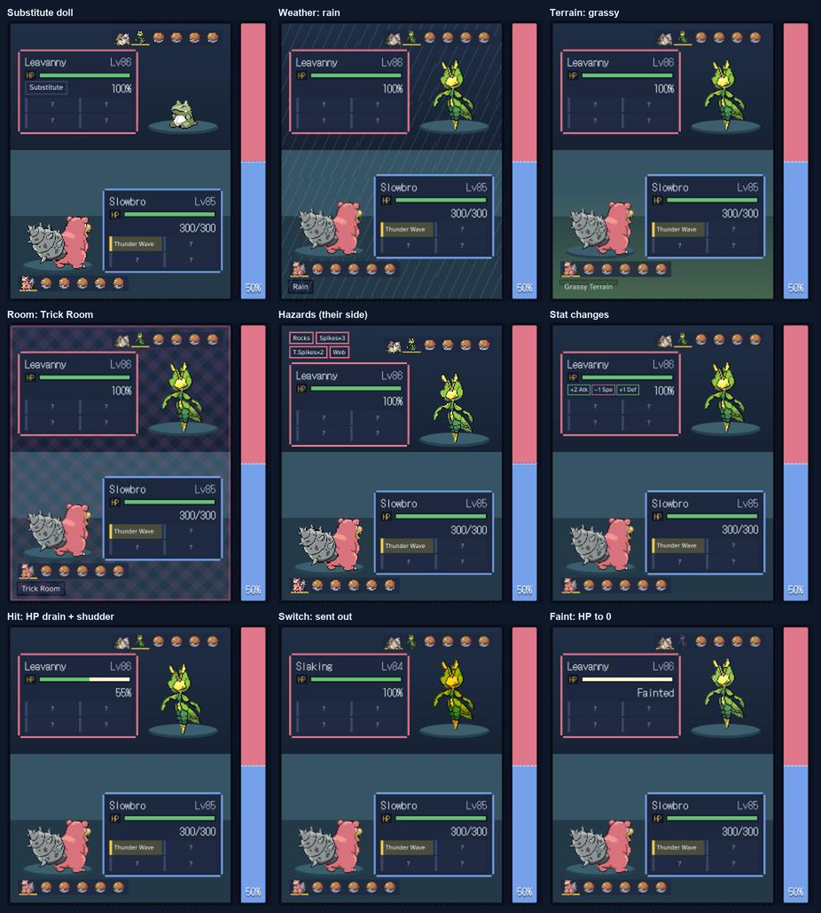

# showdown-game-review

A Lichess-style review tool for your [Pokémon Showdown](https://pokemonshowdown.com) games, running on your own computer.

- Saves your games automatically: syncs your uploaded replays by username, and an optional userscript saves every battle you play, even ones you never upload.
- Replays each game turn by turn in a Gen 4–5 style battle screen, with an eval bar and a win-chance graph.
- **Move review** (Gen 9 Random Battle): grades every choice by the win chance it gave up (?! inaccuracy, ? mistake, ?? blunder), separates decisions from luck, and gives each player an accuracy score. It grades each player only on what they could see.
- Shows everything Showdown's tooltips show: types, revealed moves, items, abilities, Tera types, possible sets with odds, and stats.



## Quick start

You need [uv](https://docs.astral.sh/uv/), [Node.js](https://nodejs.org) 20 or newer, and git. macOS or Linux.

```bash
git clone https://github.com/Codexee/showdown-game-review.git
cd showdown-game-review
./start.sh
```

The first run of `start.sh` runs `setup.sh`, which installs the Python packages (uv fetches Python 3.13 itself; PyTorch is a few hundred MB) and builds the web app. Then the app opens at <http://127.0.0.1:8765>. Enter your Showdown username and press **Sync**.

## Win-chance model

The eval bar and move review use a small network trained on Random Battle replays. Without one installed, the eval bar shows a remaining-HP estimate and move review is off.

Training your own takes some disk space (tens of GB) and hours on a laptop GPU:

```bash
uv sync                                    # adds the dev tools
./training/download_hf.sh                  # public Showdown replay logs from Hugging Face
uv run python -m training.collect --days 14   # recent replays with full battle data, for testing
RUN=my-model ./training/overnight.sh       # build the dataset, train, test, install if better
```

`overnight.sh` installs the model to `data/models/current.pt` only if it beats the one already installed. The full pipeline, its options and the test bank are described in `vault/specs/spec-eval-model.md`. The first move review also downloads and builds Showdown's simulator at the replay's version, which takes a minute.

## Save every battle (optional)

Install [Tampermonkey](https://www.tampermonkey.net/), then open the app's **Auto-save every battle** section and install the userscript. With the app running, each battle you play on play.pokemonshowdown.com is saved a few seconds after it ends. It only sends battle logs to the app on your computer, and your Showdown login stays in your browser.

## What's where

| Path | What |
|---|---|
| `server/` | FastAPI app: archive (SQLite), sync, parser, review endpoints |
| `server/review/` | Move review: choice matrices on the real simulator, sampled hidden sets |
| `web/` | The UI (Vite + TypeScript, no framework) |
| `training/` | Dataset building, training, testing and the install gate |
| `userscript/` | The Tampermonkey script |
| `vault/` | Project notes and decisions (an Obsidian vault) |
| `data/` | Your games, sprites cache and models (not in git) |

Settings via environment variables: `SGR_DATA_DIR`, `SGR_USERNAME`, `SGR_POLL_MINUTES`, `SGR_REQUEST_DELAY`, `SGR_POLLER=0` (turns the background sync off).

## Tests

```bash
uv sync && uv run python -m pytest server/tests
node --test userscript/userscript.test.mjs
```

## Credits

Battle data and sprites come from [Pokémon Showdown](https://github.com/smogon/pokemon-showdown); Random Battle set odds from [pkmn/randbats](https://data.pkmn.cc). Pokémon and its sprites are © Nintendo, Game Freak and The Pokémon Company; this is an unofficial fan project for reviewing finished games.
