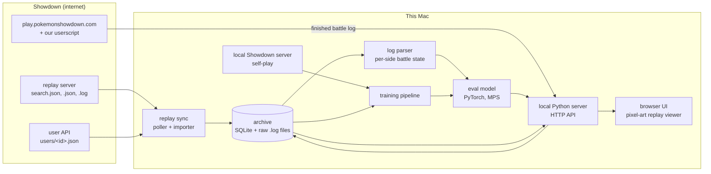

# Architecture (draft)

Nothing is built yet. This is the planned shape, from [[ADR-0001-local-web-app]] and the specs.



## Components
| Component | Job | Spec |
|---|---|---|
| Replay sync | Pull the user's ratings and new replays (public and private) | [[spec-replay-sync]] |
| Userscript | Runs on Showdown's site; posts each finished battle's log to `/api/ingest` | [[spec-replay-sync]], [[ADR-0006-replay-archive]] |
| Archive | SQLite index plus the raw `.log` file per game; never deleted | [[spec-replay-sync]], [[ADR-0006-replay-archive]] |
| Log parser | Turn a Showdown protocol log into a battle state per turn, from each player's view | [[spec-eval-model]] |
| Eval model | Value (win chance) and policy (move ranking) per turn | [[spec-eval-model]] |
| Local server | Serves the UI and an HTTP API: games list, replay, evals | [[spec-review-app]] |
| UI | Game list, replay player, eval bar, eval graph, move labels | [[spec-review-app]], [[visual-style]] |
| Training | Small test run, then an overnight run | [[spec-eval-model]], [[ADR-0005-overnight-training-budget]] |

Stack: FastAPI, Vite + TypeScript, SQLite ([[ADR-0007-app-stack]]).

## Planned code layout (draft)
```
server/      Python (FastAPI): API, sync, ingest, parser, model inference
training/    Python: datasets, training loops, self-play
web/         Vite + TypeScript frontend
userscript/  the Showdown userscript
data/        archive (git-ignored)
vault/       this vault
```

## Related
- [[project-overview]] · [[roadmap]] · [[data-sources]]
